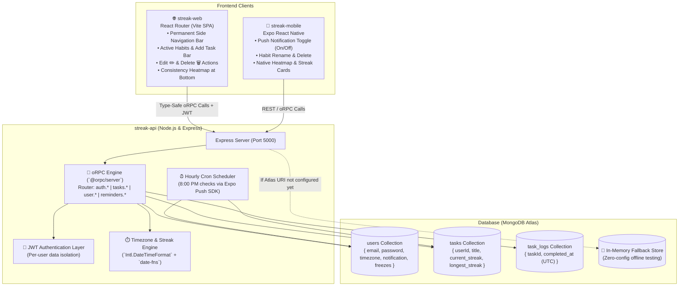

# 🔥 TaskStreak — Cross-Platform Habit & Task Tracker

> A habit tracker with seamless Web & Mobile interfaces powered having completion logs, streak freezes, and automated push notifications.

---

## 📑 Table of Contents

- [Overview](#-overview)
- [System Architecture](#-system-architecture)
- [How It Works (Core Mechanics)](#-how-it-works-core-mechanics)
  - [1. Timezone-Aware Streak Engine](#1-timezone-aware-streak-engine)
  - [2. Immutable Event Log Architecture](#2-immutable-event-log-architecture)
  - [3. Built-in User Authentication & Data Isolation](#3-built-in-user-authentication--data-isolation)
  - [4. Streak Freeze Mechanism](#4-streak-freeze-mechanism)
  - [5. Hourly Push Notification Cron](#5-hourly-push-notification-cron)
  - [6. Resilient In-Memory Fallback](#6-resilient-in-memory-fallback)
- [UI Layout Architecture](#-ui-layout-architecture)
  - [Web Client (Permanent Sidebar & Heatmap at Bottom)](#web-client)
  - [Mobile Client (Expo React Native)](#mobile-client)
- [Monorepo Project Structure](#-monorepo-project-structure)
- [Tech Stack](#-tech-stack)
- [API & oRPC Reference](#-api--orpc-reference)
- [Getting Started](#-getting-started)
  - [Prerequisites](#prerequisites)
  - [Installation](#installation)
  - [Environment Configuration (MongoDB Atlas)](#environment-configuration-mongodb-atlas)
  - [Running the Applications](#running-the-applications)
- [Running Tests](#-running-tests)
- [License](#-license)

---

## 💡 Overview

Most habit trackers fail at boundary conditions: they evaluate midnight in UTC, break streaks when users travel across timezones, or store streaks as arbitrary mutable counters (`current_streak = 5`) that are prone to client-side manipulation and desynchronization.

**TaskStreak** solves this with a modern full-stack architecture:
- **Shared Backend Logic**: Both Web and Mobile clients consume the same Express + oRPC backend, guaranteeing identical streak calculations, lock states, and history.
- **True Timezone Precision**: Completed tasks are recorded in pure UTC, but evaluated against each user's specific IANA timezone (e.g. `Asia/Calcutta`, `America/New_York`, `Europe/London`).
- **Cheat-Proof & Once-Per-Day Lock**: Once completed for the day in the user's local timezone, the action button locks until the next local calendar day arrives.
- **Per-User Isolation**: Built-in JWT authentication ensures each authenticated user exclusively accesses and manages their own habits and streaks.
- **Streak Freezes**: Missed a single day? Available streak freezes automatically protect user streaks without breaking momentum.
- **Push Notification Toggle**: Users can enable or disable 8:00 PM alerts directly in settings; background cron checks user preferences before dispatching notifications.
- **Contribution Heatmap**: Visual 365-day GitHub-style activity grid showing consistency and momentum over time.

---

## 🏗️ System Architecture



---

## ⚙️ How It Works (Core Mechanics)

### 1. Timezone-Aware Streak Engine
- When a user logs a task completion via `tasks.log`, the server gets the current UTC timestamp (`nowUtc`).
- Using the user's IANA timezone (`user.timezone`), the server converts both `nowUtc` and the task's most recent completion (`lastCompletedAtUtc`) into local calendar date strings (`YYYY-MM-DD`) via `Intl.DateTimeFormat`.
- The difference in calendar days (`diffDays`) is computed:
  - **`diffDays === 0` (Same Day)**: The task was already completed today in the user's local timezone. The request returns an error and keeps the button locked.
  - **`diffDays === 1` (Consecutive Day)**: Valid streak continuation! The streak increments by 1 (`newStreak = currentStreak + 1`), updating `longest_streak` if a new personal best is reached.
  - **`diffDays === 2` (1 Missed Day with Freeze Available)**: The user missed yesterday, but has `streak_freezes_available > 0`. The streak is saved, incremented, and 1 freeze is deducted.
  - **`diffDays > 1` (Streak Broken)**: The gap exceeds 1 day or no freezes are left. The streak resets to `1`.

### 2. Immutable Event Log Architecture
TaskStreak does not treat streaks as isolated numbers. Every completion appends an immutable entry to `task_logs` in MongoDB:
- Prevents client-side tampering.
- Allows retrospective auditing, streak recalculations, and time-travel debugging.
- Feeds data directly into the GitHub-style **Activity Heatmap**.

### 3. Built-in User Authentication & Data Isolation
- Built-in, zero-third-party JWT authentication with password hashing (`bcryptjs`).
- Procedures: `auth.register`, `auth.login`, `auth.me`.
- Every habit, streak count, and log entry is scoped to the authenticated user's `userId`. User B cannot see or manipulate User A's data.

### 4. Streak Freeze Mechanism
- Users have a configurable balance of streak freezes (2 by default).
- When a user misses one day (`diffDays === 2`), the backend automatically applies a freeze, preserving the streak and decrementing the user's freeze counter.

### 5. Hourly Push Notification Cron
- An hourly background job runs at minute zero (`0 * * * *`) via `node-cron`.
- Inspects all users whose notification preference is set to `'enabled'`.
- Calculates current local time in each user's specific timezone.
- If it is **8:00 PM (20:00)** in their timezone and any habit remains uncompleted, fires a reminder via the Expo Push Notification service.

### 6. Resilient In-Memory Fallback
- If `MONGODB_URI` is not configured or unreachable, `streak-api` automatically operates in high-fidelity in-memory fallback mode.
- You can clone, test, and run the complete system out-of-the-box before pasting your MongoDB Atlas connection string.

---

## 🎨 UI Layout Architecture

### Web Client
Featuring a permanent full-height left side navigation bar with **no top header**:

```
┌───────────────────────────┬─────────────────────────────────────────────────────────────┐
│ 🚀 TaskStreak             │  🔥 ACTIVE HABITS                     3 Habits Active       │
│                           ├─────────────────────────────────────────────────────────────┤
│ 👤 Profile (At Top)       │  [ ➕  Enter habit title...             ] [ + Add Habit ]   │
│    alex@taskstreak.dev    │  ▲ (Add Task Bar directly below Active Habits header)       │
│    ❄️ 2 Freezes Available │                                                             │
│    [ Log Out ]            │  ┌───────────────────────┐   ┌───────────────────────────┐  │
│ ───────────────────────── │  │ Study Java & DSA ✏️ 🗑️ │   │ Morning 5km Run     ✏️ 🗑️ │  │
│                           │  │ 14 Days Streak 🔥     │   │ 5 Days Streak 🔥          │  │
│ 📁 Active Habits          │  │ [✓ Done Today (Locked)│   │ [Mark as Done Today 🔥]   │  │
│ 📈 Completed Today (1/3)  │  └───────────────────────┘   └───────────────────────────┘  │
│                           │                                                             │
│                           ├─────────────────────────────────────────────────────────────┤
│ ───────────────────────── │  📊 CONSISTENCY MATRIX (HEATMAP AT BOTTOM)                  │
│ ⚙️ Settings (At Bottom)   │  Selected Habit: Study Java & DSA                           │
│    Timezone: Asia/Calcutta│  [ ■ ■ ■ ⬚ ■ ■ ■ ■ ■ ■ ■ ■ ■ ■ ■ ■ ■ ■ ■ ■ ■ ■ ■ ■ ■ ■ ■ ]  │
│    🔔 8 PM Reminders: On  │                                                             │
└───────────────────────────┴─────────────────────────────────────────────────────────────┘
  ▲ Permanent Sidebar           ▲ Fluid Main Content (Cards on top, Heatmap at bottom)
```

- **Permanent Sidebar**:
  - **Profile at Top**: User avatar, email address, streak freeze badge (`❄️ 2 Freezes Available`), and Log Out / Sign In action.
  - **Settings at Bottom**: Dynamic timezone selector and 8:00 PM reminder toggle.
- **Main Page**:
  - **Active Habits Header Bar** at top with stats.
  - **Add Task Input Bar** located **directly below the Active Habits header bar**.
  - **Task Cards**: Include **Edit Button (✏️)** to rename the habit, **Delete Button (🗑️)** to permanently delete it, streak counts, and lock-aware Done button.
  - **Consistency Matrix (Heatmap)**: Positioned at the **bottom of the screen**.

### Mobile Client
- **Task Feed**: Native card list with bouncing fire animations, edit (`✏️`) and delete (`🗑️`) buttons, and lock status.
- **Settings Screen**: Push Notification Enable/Disable toggle switch (`notification: 'enabled' | 'disabled'`), timezone selector, and freeze counter.

---

## 📂 Monorepo Project Structure

```
TaskStreak/
├── package.json                 # Monorepo workspaces & shared root scripts
├── README.md                    # Project documentation (this file)
│
├── streak-api/                  # Node.js/Express Backend with oRPC & MongoDB
│   ├── db/
│   │   └── mongo.js             # Mongoose connection with resilient fallback
│   ├── models/
│   │   ├── User.js              # User schema (email, password, timezone, notification)
│   │   ├── Task.js              # Task schema (userId, title, streaks)
│   │   └── TaskLog.js           # TaskLog schema (taskId, completed_at UTC)
│   ├── orpc/
│   │   └── router.js            # Type-safe oRPC Router (auth, tasks, user, reminders)
│   ├── services/
│   │   ├── taskService.js       # Core business & data access service
│   │   └── notifier.js          # Hourly cron job & Expo Push Notifications
│   ├── utils/
│   │   └── streakCalculator.js  # Timezone date math & streak evaluation
│   ├── tests/
│   │   ├── streakCalculator.test.js # Streak calculator boundary tests
│   │   └── orpcIntegration.test.js  # oRPC client & auth integration tests
│   ├── server.js                # Express app setup & oRPC handler mounting
│   ├── .env.example             # Environment template for MongoDB Atlas
│   └── package.json
│
├── streak-web/                  # React Router (Vite SPA) Web App
│   ├── src/
│   │   ├── components/
│   │   │   ├── Sidebar.tsx      # Permanent side navigation bar
│   │   │   ├── Heatmap.tsx      # Consistency matrix (365-day activity grid)
│   │   │   └── AuthModal.tsx    # Sign In / Register modal
│   │   ├── pages/
│   │   │   └── Dashboard.tsx    # Main dashboard with cards, add bar & heatmap
│   │   ├── lib/
│   │   │   └── orpc.ts          # Type-safe oRPC client configuration
│   │   ├── App.tsx              # React Router setup
│   │   ├── main.tsx             # Vite entrypoint
│   │   └── index.css            # Tailwind CSS v4 styling
│   ├── vite.config.ts           # Vite configuration with Tailwind plugin
│   ├── index.html               # SPA root HTML
│   └── package.json
│
└── streak-mobile/               # Expo React Native Mobile App
    ├── screens/
    │   ├── DashboardScreen.tsx  # Native habit checklist, edit modal, and heatmap
    │   └── SettingsScreen.tsx   # Push notification toggle & timezone selector
    ├── components/
    │   ├── TaskCard.tsx         # Task item card with edit (✏️) and delete (🗑️)
    │   └── Heatmap.tsx          # Mobile consistency visualizer
    ├── hooks/
    │   └── useTasks.ts          # State management & network synchronization
    ├── App.tsx                  # Root navigation stack setup
    ├── app.json                 # Expo project manifest
    └── package.json
```

---

## 🛠️ Tech Stack

| Domain | Technology | Description |
|---|---|---|
| **Backend Framework** | Node.js / Express | Server hosting oRPC router & cron jobs |
| **API Protocol** | oRPC (`@orpc/server`, `@orpc/client`) | End-to-end type-safe RPC with Zod validation |
| **Database & ODM** | MongoDB Atlas / Mongoose | Scalable document store with compound indexes |
| **Authentication** | JWT + bcryptjs | Secure password hashing & per-user data isolation |
| **Date & Time Engine** | `Intl.DateTimeFormat`, `date-fns` | Accurate IANA timezone calculations |
| **Notifications** | `node-cron`, `expo-server-sdk` | Timezone-aware hourly reminder triggers |
| **Web Frontend** | React Router, Vite, React 19, TypeScript | Fast SPA with permanent side navbar layout |
| **Web Styling** | Tailwind CSS v4, Lucide Icons, Canvas-Confetti | Modern dark glassmorphism theme |
| **Mobile Frontend** | React Native, Expo (SDK 57) | Native cross-platform iOS & Android mobile app |

---

## 🔌 API & oRPC Reference

### oRPC Procedures (`/rpc`)

#### 1. Authentication
- `auth.register({ email, password, timezone? })` — Registers user, hashes password, returns `{ token, user }`.
- `auth.login({ email, password })` — Authenticates user, returns `{ token, user }`.
- `auth.me()` — Returns current authenticated user profile.

#### 2. Habits / Tasks
- `tasks.list()` — Returns all habits for the authenticated user with computed `completed_today` and `is_locked`.
- `tasks.create({ title })` — Creates a new habit for the authenticated user.
- `tasks.update({ taskId, title })` — Renames a habit in MongoDB.
- `tasks.delete({ taskId })` — Permanently deletes habit and historical logs from MongoDB.
- `tasks.log({ taskId, simulatedNowUtc? })` — Marks habit as done for today in user's timezone; enforces single-completion lock and auto-consumes streak freezes.
- `tasks.logs({ taskId })` — Returns historical completion timestamps for heatmap rendering.

#### 3. User & Settings
- `user.get()` — Returns user profile, timezone, freeze balance, and notification status.
- `user.update({ timezone?, expo_push_token?, notification? })` — Updates user settings (`notification: 'enabled' | 'disabled'`).

#### 4. Developer & Testing Tools
- `reminders.test()` — Triggers dry-run of the 8:00 PM timezone notification check.
- `GET /health` — Health check endpoint.

---

## 🚀 Getting Started

### Prerequisites
- [Node.js](https://nodejs.org/) (v18.x or newer recommended)
- [npm](https://www.npmjs.com/) (v9.x or newer)
- *(Optional)* [MongoDB Atlas](https://www.mongodb.com/atlas) account — **Note**: If MongoDB URI is not set, the app will run in fallback mock mode out-of-the-box!

### Installation

```bash
# Clone the repository
git clone https://github.com/i0verlord/TaskStreak.git
cd TaskStreak

# Install all dependencies across all workspaces
npm install
```

### Environment Configuration (MongoDB Atlas)

Configure environment variables in `streak-api/.env`:

```bash
cd streak-api
cp .env.example .env
```

Settings in `streak-api/.env`:
```env
PORT=5000
MONGODB_URI=mongodb+srv://<username>:<password>@cluster0.mongodb.net/taskstreak?retryWrites=true&w=majority
JWT_SECRET=taskstreak-secret-jwt-key-2026
NODE_ENV=development
```

### Running the Applications

#### 1. Start the Backend (Express + oRPC)
```bash
npm run api
```
*API runs at [http://localhost:5000](http://localhost:5000), oRPC at [http://localhost:5000/rpc](http://localhost:5000/rpc)*

#### 2. Start the Web App (React Router + Vite)
```bash
npm run web
```
*Web dashboard will be available at [http://localhost:3000](http://localhost:3000)*

#### 3. Start the Mobile App (Expo React Native)
```bash
npm run mobile
```
*Scan the QR code with Expo Go (Android/iOS) or press `w` to view in your web browser.*

---

## 🧪 Running Tests

### 1. Streak Engine Unit Tests
Tests timezone boundaries, consecutive day increments, same-day locks, and freeze deductions:
```bash
npm run test:api
```

### 2. oRPC Client & Authentication Integration Tests
Validates JWT registration, login, task creation, rename, delete, and per-user data isolation:
```bash
npm run test:orpc
```

### 3. Production Web Build
```bash
npm run build:web
```

---

## 📄 License

This project is licensed under the [MIT License](LICENSE).