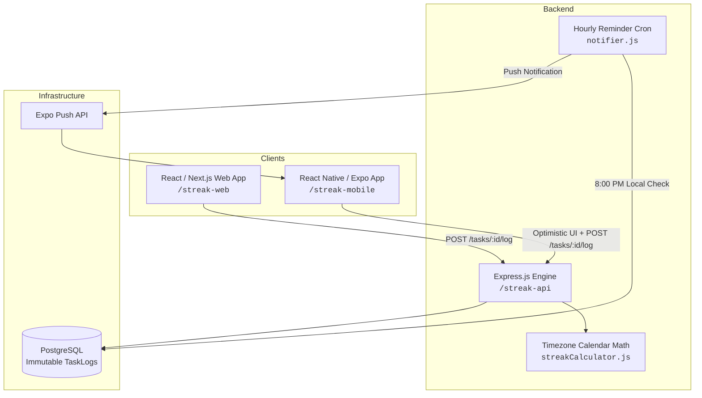

# 🔥 TaskStreak — Cross-Platform Habit & Task Tracker

> A resilient, timezone-aware cross-platform habit tracker built with **React (Next.js)**, **React Native (Expo)**, and a unified **Node.js/Express + PostgreSQL** backend.

---

## 🏗️ 1. Core Architecture

TaskStreak synchronizes streak evaluations seamlessly across Web and Mobile with strict anti-cheating protections:



1. **The Clients (Web & Mobile)**:
   - Calculate locally if the "Done" button should be locked for the rest of the day based on the user's local timezone.
   - Employ **Optimistic UI Updates** on mobile and web: clicking "Done" immediately increments the streak and locks the button before awaiting the network roundtrip.
2. **The Database (PostgreSQL)**:
   - Does not just store a raw mutable number. Stores an **immutable log (`task_logs`)** of every single completion in UTC.
   - Facilitates streak recalculations and GitHub-style 365-day heatmaps.
3. **The Push Notification Hook**:
   - An hourly cron checks each user's timezone.
   - If it is 8:00 PM in the user's local timezone and an active habit remains uncompleted, an Expo push notification is dispatched (e.g. *"You are about to lose your 14-day Java streak!"*).

---

## ⚡ 2. The Streak Engine Algorithm

Never trust the user's phone time, and never evaluate streaks using raw UTC timestamps (which break late at night across international timezones).

### Evaluation Flow
1. **Store UTC, Evaluate Locally**: All completion events are recorded with strict UTC timestamps (`NOW()`).
2. **Local Calendar Mapping**: The server retrieves the user's IANA timezone (e.g., `Asia/Calcutta`, `America/New_York`) and maps UTC timestamps into calendar dates (`YYYY-MM-DD`).
3. **Calendar Difference Math**:
   - **`Difference = 0 days` (Same day)**: Button is locked. Redundant completion requests are blocked (`400 Bad Request`).
   - **`Difference = 1 day` (Yesterday)**: Valid consecutive streak continuation. Increments current streak by `+1`.
   - **`Difference = 2 days` (1 missed day)**: If the user possesses an available **Streak Freeze** (`streak_freezes_available > 0`), the freeze is consumed and the streak continues (`+1`).
   - **`Difference > 1 day` (Missed without freeze)**: The streak breaks and resets cleanly to `1`, preserving the all-time `longest_streak`.

---

## 📁 3. Project Blueprint & File Structure

```text
TaskStreak/
├── package.json              # Workspace runner commands
├── .gitignore                # Root gitignore for build artifacts & node_modules
├── README.md                 # Complete documentation & setup instructions
│
├── streak-api/               # Node.js / Express Backend
│   ├── server.js             # Express server setup & routes
│   ├── schema.sql            # PostgreSQL schema (users, tasks, task_logs)
│   ├── db.js                 # PostgreSQL connection pool with mock fallback
│   ├── package.json          # Express, pg, date-fns, node-cron, expo-server-sdk
│   ├── .env.example          # Sample environment variables
│   ├── controllers/
│   │   └── taskController.js # Core /tasks/:id/log endpoint & handlers
│   ├── services/
│   │   └── notifier.js       # Hourly 8:00 PM Expo Push Notification cron
│   ├── utils/
│   │   └── streakCalculator.js# Timezone math & freeze evaluation
│   └── tests/
│       └── streakCalculator.test.js # Engine verification unit tests
│
├── streak-mobile/            # React Native / Expo Mobile App
│   ├── App.tsx               # Navigation container with Dark Theme
│   ├── package.json          # Expo SDK 57, React Native 0.86, Reanimated
│   ├── screens/
│   │   ├── DashboardScreen.tsx# Task list, pull-to-refresh, freeze status
│   │   └── SettingsScreen.tsx # Timezone selector & push configuration
│   ├── components/
│   │   └── TaskCard.tsx      # Card with Reanimated bouncing fire emoji 🔥 & Done button
│   ├── hooks/
│   │   └── useTasks.ts       # Optimistic UI update hook
│   └── utils/
│       └── dateMath.ts       # Client-side daily lock detection
│
└── streak-web/               # Next.js Web Dashboard
    ├── package.json          # Next.js 15, React 19, TailwindCSS, Lucide, Confetti
    └── src/
        ├── app/
        │   ├── layout.tsx    # App root layout & theme
        │   ├── page.tsx      # Web dashboard with timezone selector & cards
        │   └── globals.css   # TailwindCSS styling
        └── components/
            └── Heatmap.tsx   # GitHub-style 52-week activity heatmap
```

---

## 🚀 4. Quick Start Guide

### Prerequisites
- **Node.js** (v20+ recommended)
- **npm** (v10+)
- *(Optional)* **PostgreSQL** (The API automatically operates in high-fidelity mock fallback mode if PostgreSQL is not active locally!)

---

### Step 1: Start the Backend API (`/streak-api`)

```bash
cd streak-api
npm install
npm run dev
```

Server will start on `http://localhost:5000`.

To run the streak engine test suite:
```bash
npm test
```

---

### Step 2: Start the Web Dashboard (`/streak-web`)

```bash
cd streak-web
npm install
npm run dev
```

Open `http://localhost:3000` in your browser.

---

### Step 3: Start the Mobile App (`/streak-mobile`)

```bash
cd streak-mobile
npm install
npx expo start
```

Press `w` to open in web browser, or scan the QR code using the **Expo Go** app on iOS / Android.

---

## 📡 5. API Reference

| Method | Endpoint | Description |
|---|---|---|
| `GET` | `/api/tasks?userId=1` | Get tasks with local completion lock status |
| `POST` | `/api/tasks` | Create a new habit/task |
| `POST` | `/api/tasks/:id/log` | Primary action: Mark habit as Done (runs timezone algorithm) |
| `GET` | `/api/tasks/:id/logs` | Query immutable logs for the 365-day Heatmap |
| `GET` | `/api/users/:id` | Fetch user profile, timezone, and freeze count |
| `PUT` | `/api/users/:id` | Update user timezone or Expo push token |
| `POST` | `/api/test/reminders` | Trigger test run of the 8:00 PM notification cron |

---

## 🛡️ License
MIT License.
